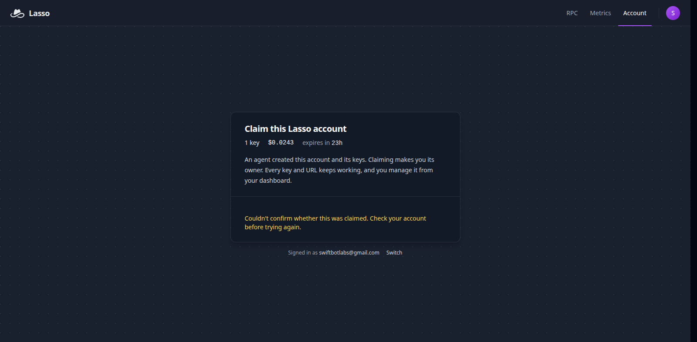

# Lasso RPC: first-week feedback from a small on-chain tooling team

We run small on-chain scanners that read contract state and events on Base, Arbitrum, Ethereum and Tempo. They are mostly `eth_call` loops plus `eth_getLogs` backfills. On 2026-10-28 (05:00-05:45 UTC) we pointed them at [lasso.sh](https://lasso.sh) through the agent path and logged what happened.

## What we ran

- Key: one `POST /api/v1/keys`, no signup. `serving_ready: true` on the first call.
- Our real scanner (an `eth_call` scan of one contract's claims), unchanged except for the RPC URL:

| Route | Chain | Wall time for the same scan |
|---|---|---|
| `premium` (default strategy) | Base | 7.7 s |
| direct `mainnet.base.org` | Base | 9.8 s |
| `public` | Base | 12.3 s |
| `premium` | Arbitrum | 1.3 s |
| `public` | Arbitrum | 2.5 s |
| `public` | Ethereum | 8.5 s |

- Probes with `?include_meta=body`: `eth_blockNumber`, batches, `eth_getLogs` ranges, an unsupported method and a bad chain name, plus Tempo (chain 4217).

## What worked well

- **The agent path is the right shape.** One HTTP call gives a key, an RPC URL, a WS URL and a management token. No dashboard detour.
- **Evidence on every response.**
  - `x-lasso-usd`: $0.00001 per premium call. `x-lasso-balance-usd`, `x-lasso-cu` and the rate-limit headers come with each response.
  - `lasso_meta` names the candidates, the selected provider, upstream latency and Lasso's own overhead.
  - `premium/fastest/base`: 20.9 ms upstream. Public: 232 ms. Lasso overhead about 2 ms.
- **Errors carry `next_action`.** A typo in the chain name returned `unknown_chain` with "Choose a chain from /agent.json". That is exactly what a script needs.
- **Tempo is supported.** We use Tempo, so this matters to us.

## Issues, with request IDs

### 1. `eth_getLogs` range refusals that one pool provider would serve

Target: contract `0x5555Fa783936C260f77385b4E153B9725feF1719` on Base. It has 26 logs in the last 50,000 blocks.

| Span (blocks) | Lasso `public/base` | Lasso `premium/base` | `base-rpc.publicnode.com` direct |
|---|---|---|---|
| 100 | 0 logs | 0 logs | 0 logs |
| 500 | `log_range_limit` (`GOKbEBSz2jomflgAAx9E`) | 1 log; refused 20 min earlier (`GOKac4qXjo5-xwMADaji` at 500k) | 1 log |
| 2,000 | `log_range_limit` (`GOKbEIQ15nheqZcADc2i`) | `log_range_limit` after 5 premium + 2 public candidates | 3 logs |
| 50,000 | `log_range_limit` (`GOKbEQEMpGQgFQoAD6hB`) | `log_range_limit` | 26 logs |

- **The pool already has a provider that can serve these ranges.**
  - On `public/base`, `eth_getLogs` candidates were `base_official`, `base_drpc` and `public-safe/base_paid_reserve`.
  - `base_publicnode` serves 50,000-block ranges directly and served our `eth_gasPrice` from the same pool, but was never tried.
- **`retryable: false` with "reduce the block range" leaves the client guessing.** In about 30 minutes, the cutoff we saw moved between 100 and 500 blocks.

Suggestions, in order of value:
1. Route large ranges to providers learned to accept them, or split the range and merge the results.
2. Put the largest range Lasso would accept right now in `error.data` (e.g. `max_block_range`), so a client can chunk in one step.

For a log-heavy indexer this is the one blocker. Everything else here is polish.

### 2. Claim link: the button appears late, then the claim fails silently twice

Steps:
1. `POST /api/v1/accounts/{id}/claim-link` → open it.
2. Sign in with GitHub (read-only email scope), then an email code.
3. The claim page renders "Signed in as …" with **no Claim button** for about 20 s. It came back on reload, about 21 s after load. The page looks finished, so a person would leave.
4. **Claim → "Claiming…" → "Couldn't confirm whether this was claimed. Check your account before trying again."** The same thing happened on a second try.

Afterwards:
- `GET /api/v1/accounts/{id}` still reports `provisional: true` with `people: 0`.
- The dashboard at `/account` shows a new, empty account ("Create your first endpoint").
- So the person now has two accounts, and the agent's key was not handed over.

Times: 05:36-05:40 UTC.

### 3. Small things

- **`debug_traceTransaction` on public:**
  - It was retried twice across providers, then returned the upstream's `code: 5`, "expect 2 arguments".
  - An invalid-params error is a client fault. Fail fast and normalise it to `-32602`, as the other errors are.
- **GitHub sign-in still needs an email code.** It's fine, but GitHub already verified the address.

## Would we use it?

- **Yes, for the `eth_call` side today.** `premium/fastest` was quicker than calling the chain's own endpoint, and per-call cost is visible in headers.
- **For backfills,** we'll use it once issue 1 is handled.
- **Self-hosting with our own provider list for Base and Tempo** is the plan we'd test next.

## Reproduce

- [`scripts/repro_getlogs.sh`](scripts/repro_getlogs.sh): set `LASSO_RPC_URL`, then run it.
- It compares `public`, `premium` and publicnode for the same ranges, and prints candidates and request IDs. It prints no secrets.

Swift Bot Labs · [github.com/swiftbotlab](https://github.com/swiftbotlab) · X [@swiftbotlab](https://x.com/swiftbotlab) · Farcaster [swiftbotlab](https://farcaster.xyz/swiftbotlab)
